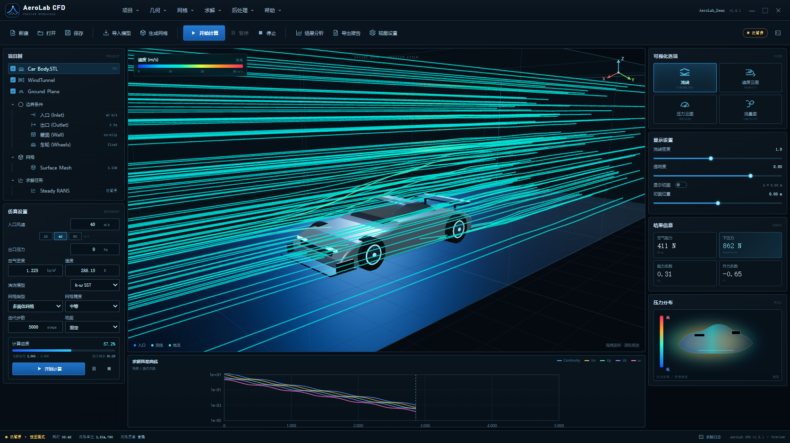

# AeroLab CFD

AeroLab CFD is an interactive **virtual wind tunnel and CFD workspace** delivered as a persistent **DSH Web UI plugin** — not a desktop application.

It turns the workflow described in the V2 requirements into a browser-native workspace: project tree, boundary conditions, mesh generation, a running residual history, preview force coefficients, STL/OBJ import, streamlines, velocity/pressure contours, vorticity, a wall-pressure map, project save/open and a Markdown report export.

> **Important:** this repository is a reduced-order interactive **preview**, not OpenFOAM and not a validated CFD solver. The numbers and fields are generated by a deterministic preview model so the complete workflow can be demonstrated inside DSH. See [`docs/preview-model.md`](docs/preview-model.md).



*Headless component render of the actual plugin UI (not a DSH page screenshot), used for visual verification.*

## What is implemented

- **Desktop-style dark CFD workspace** with title bar, menus, toolbar, project tree, settings, 3D viewport, visualization rail, residual chart and status bar.
- **Geometry:** built-in mid-engine demo car, STL / OBJ / GLB / embedded glTF import (25 MB), auto-centering and ground alignment.
- **Boundary setup:** inlet velocity, outlet pressure, air density, temperature, turbulence model, mesh type/level, iteration count, ground mode.
- **Mesh:** deterministic cell-count model, quality state, progress animation, stale-mesh guard.
- **Preview solve:** start/pause/stop, iteration progress, ETA, five residual series, logs, state-aware toolbar.
- **Results:** drag, downforce, Cd, Cl, drag power, Reynolds number, frontal area; formulas and assumptions in the preview-model document.
- **3D visualization:** colored thick streamlines, velocity/pressure/vorticity slice fields, adjustable streamline density, opacity, slice position, car/tunnel/ground/grid visibility and camera presets.
- **Project workflow:** new/open/save JSON project, Markdown report export, import status, toast notifications and keyboard close.
- **Bilingual metadata:** Chinese-first UI; en/zh locale resources are registered with DSH.
- **Deployment:** CI, tag-driven release, packaged runtime zip and cross-machine install scripts.

## Install in DSH

### Option A — local bundle (recommended for development)

```bash
git clone https://github.com/YChoux-Pan/aerolab-cfd.git
cd aerolab-cfd
```

Open DSH Web → **Plugins** → add/install a local bundle → select this repository's `plugin/` directory. Enable **AeroLab CFD** (`aerolab-cfd`).

Or use the CLI:

```bash
dsh plugin --profile desktop add "<absolute-path>/aerolab-cfd/plugin"
```

### Option B — release zip

Download `aerolab-cfd-plugin-v1.0.1.zip` from the [Releases](https://github.com/YChoux-Pan/aerolab-cfd/releases) page, extract it, then select the extracted `aerolab-cfd/` folder in DSH Plugins and enable the bundle.

### Option C — helper script

```powershell
powershell -ExecutionPolicy Bypass -File scripts/install-plugin.ps1
```

```bash
bash scripts/install-plugin.sh
```

If the bundle is not auto-selected, enable it once in **Plugins** and refresh/restart DSH. See [`docs/installation.md`](docs/installation.md).

## Repository map

```text
aerolab-cfd/
├── plugin/
│   ├── source/
│   │   ├── client.jsx      React workspace UI and state
│   │   ├── scene.js        Three.js tunnel, car, streamlines, contours
│   │   ├── models.js       procedural demo car + imported mesh treatment
│   │   ├── importers.js    STL / OBJ / GLB / glTF
│   │   ├── solver.js       preview metrics, residuals, project schema
│   │   └── entry.jsx       DSH module-loader bootstrap
│   ├── locale/             Chinese / English resources
│   ├── tools/              esbuild workspace
│   └── client.js           committed runtime bundle
├── scripts/                verify, package, install helpers
├── docs/                   architecture, preview boundary, deployment, validation
└── .github/workflows/      CI and tagged release
```

## Build and verify

```bash
cd plugin/tools
pnpm install --frozen-lockfile
node build.mjs
cd ../..
node --check plugin/client.js
node scripts/verify.mjs
node scripts/package-plugin.mjs
```

The committed `plugin/client.js` is the runtime; React is supplied by DSH and is external to the bundle.

## Preview model boundary

AeroLab CFD does **not** launch OpenFOAM, generate a real polyhedral mesh, or solve Navier–Stokes equations in the browser. The preview:

- uses a transparent force model (`q = ½ρv²`, `F = q·Cd·A`, downforce from a preview Cl);
- integrates a visual velocity field for streamlines and slices;
- advances a deterministic residual history and solver state for interaction design;
- keeps the UI language explicit: **PREVIEW FIELD**, **not a CFD result**.

A real engineering path would replace the preview adapter with a job service that writes an OpenFOAM case, runs `blockMesh`/`snappyHexMesh`/`simpleFoam`, and streams VTK results. The UI is structured for that boundary. See [`docs/preview-model.md`](docs/preview-model.md) and [`docs/architecture.md`](docs/architecture.md).

## Documentation

- [Installation](docs/installation.md)
- [Architecture](docs/architecture.md)
- [Preview model and limitations](docs/preview-model.md)
- [Deployment from another computer](docs/deployment.md)
- [Validation checklist](docs/validation.md)
- [Engineering journal](docs/journal.md)

## License

MIT for AeroLab CFD code and assets. Three.js is MIT; see [`THIRD_PARTY_NOTICES.md`](plugin/THIRD_PARTY_NOTICES.md). AeroLab CFD is not affiliated with any vehicle manufacturer or CFD vendor.
